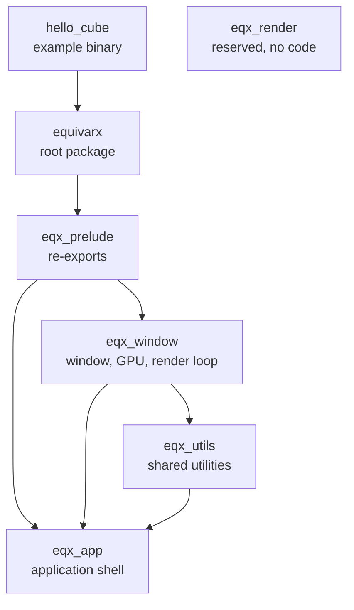
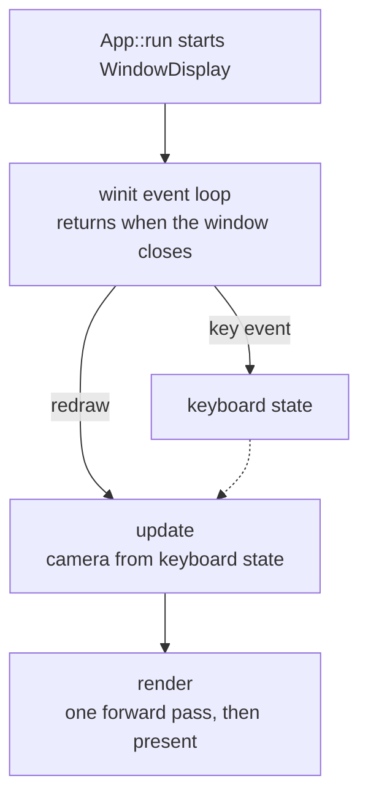

# Equivarx Architecture

How Equivarx is put together now: crate responsibilities, dependency direction, ownership, the frame and data flow, and the rules that span crates. This file records only what a design decision changes. Detail that a routine change could make false belongs in the code's own docs, such as the `//!` comment at the top of a crate's `lib.rs`.

This file is the single source of the Claude artifact [Equivarx Architecture](https://claude.ai/artifact/QKnctCjbi8ZRx6FXc9hbfh), which renders it. Revise it in the same change as any design decision that alters what it describes, and check it at each roadmap stage's Close step; after editing it, republish the artifact. Its git history is the record of how the architecture changed, and plans live in `docs/roadmap/`.

## Crates

Arrows point from a crate to the crates it depends on, as declared in each `Cargo.toml`.

| Crate | Responsibility |
|---|---|
| `hello_cube` | Example binary that runs the engine through `App` |
| `equivarx` | Root package: the engine's public API, re-exported from `eqx_prelude` |
| `eqx_prelude` | Gathers each crate's public items into one prelude |
| `eqx_app` | Application shell: `App` loads `Module`s and starts them |
| `eqx_window` | Window, GPU device and surface, the render loop, and basic rendering (camera, meshes, textures, asset loading) |
| `eqx_utils` | Utilities shared by engine crates: keyboard state, shader and asset path lookup |
| `eqx_render` | Reserved for deeper rendering algorithms such as mist; holds no code yet |

wgpu provides the GPU API, winit the window and its events, and glam the math.

## Ownership

`WindowDisplay` is the only module. When started, it creates the window and a single `State` struct that owns the GPU device and surface, the render pipeline, the scene, the camera and the keyboard state, and borrows the window. No other crate holds GPU objects.

## Frame and data flow

`App::run` starts each module in load order, and `WindowDisplay` runs winit's event loop inside that call. Key events update the keyboard state. Each redraw moves the camera from that state, uploads the camera matrix, and draws the scene in one forward render pass. Shaders are read from the source tree at run time, and models and textures from Cargo's build output folder (`OUT_DIR`).

## Rules that span crates

- Users of the engine reach it only through the root package, which re-exports `eqx_prelude`.
- Deep rendering algorithms such as mist go in `eqx_render`; window and device setup stay in `eqx_window`.
- Code that serves one consumer stays with it until a second, exactly matching use case appears (`docs/memory/single-consumer-code-stays-put.md`).

## Structural limits

What the current design does not support, measured against the rendering roadmap's rules.

- `Module::init` holds the event loop and never returns, so `Module::update` never runs and a module loaded after `WindowDisplay` never starts.
- `State` borrows the window, so the window, the surface and the renderer must live in the one stack frame that never returns.
- The renderer is not a function of a per-frame description: device, surface, pipeline, scene and camera are one struct, with no headless path and no pass list.
- Shaders and assets are located through paths on the machine that built the code, and the example runs only with `OUT_DIR` set by hand.
- `eqx_render` holds no code.

The next design change is Stage 0, the bench, in `docs/roadmap/rendering.md`.
